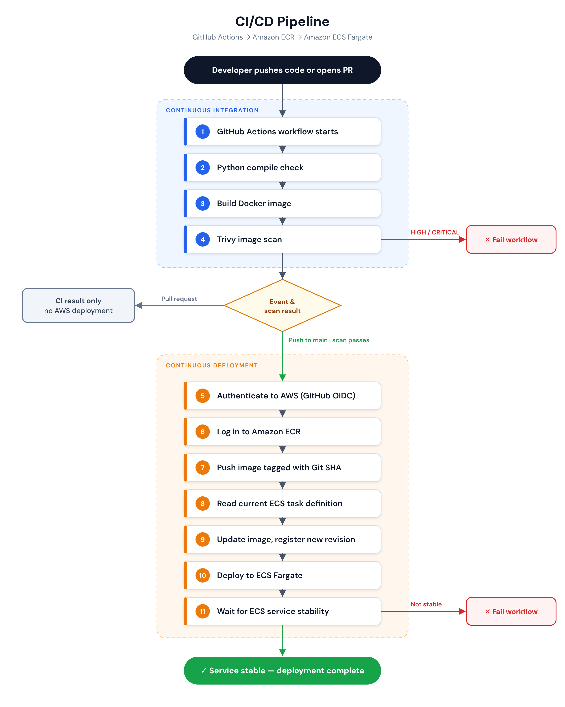

# AWS CI/CD Platform — GitHub Actions & Terraform

An end-to-end, production-style AWS deployment project demonstrating containerization, Infrastructure as Code, automated CI/CD, image security scanning, and secure application-to-database connectivity. The application is packaged with Docker, stored in Amazon ECR, and deployed to Amazon ECS on Fargate through GitHub Actions. Terraform provisions the AWS infrastructure.

## Architecture

### Request and data flow

1. Users access the application through the internet-facing Application Load Balancer (ALB) on HTTP port `80`.
2. The ALB forwards requests to the ECS Fargate service on container port `8000`.
3. Fargate tasks run in private subnets without public IP addresses. The service security group accepts application traffic only from the ALB security group.
4. The application connects to private Amazon RDS for PostgreSQL on port `5432`. The database security group accepts traffic only from the ECS security group.
5. ECS retrieves database settings from AWS Secrets Manager. The task execution role is scoped to the required secret.
6. ECS pulls the container image from Amazon ECR and sends application logs to CloudWatch Logs.

## CI/CD pipeline

## Security considerations

- Keep ECS tasks and RDS in private subnets.
- Restrict ALB-to-ECS and ECS-to-RDS traffic using security-group references.
- Use GitHub OIDC rather than storing long-lived AWS access keys in GitHub.
- Scope IAM permissions to the required ECR, ECS, logging, and secret resources.
- Store database credentials in Secrets Manager; never hard-code them in source code or the Docker image.
- Scan container images with Trivy before deployment.
- Keep `.tfstate`, `.tfvars` containing secrets, `.env` files, and credentials out of Git.

